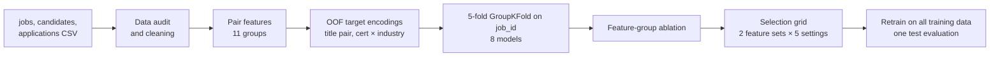

<div align="center">


</div>

# Ranking Job Applicants with Learning to Rank

For each job posting, order its applicants from best to worst fit. The project covers data cleaning, job–candidate features, group-aware cross-validation, eight models, a feature-group ablation and one final evaluation on held-out test jobs.

<div align="left">

[](https://www.python.org/downloads/)
[](https://lightgbm.readthedocs.io)
[](https://xgboost.readthedocs.io)
[](https://scikit-learn.org)
[](https://github.com/faezehmzf/job-candidate-ranking/actions/workflows/tests.yml)
[](LICENSE)

</div>

## Abstract

Every job is treated as a query and its applicants as the documents to rank, with quality measured inside each job by NDCG@10. The data has 5,000 synthetic tech job postings, 50,000 candidate profiles and 171,472 applications labelled from 0 (no fit) to 4 (ideal).

- **Cleaning.** Currencies, date formats, title spellings, education names and two English-level scales are normalised. The IRR exchange rate is estimated from the data itself.
- **Features.** 51 job–candidate features in 11 groups, including skill coverage, experience gaps, seniority and role-family match, location and salary fit, and two out-of-fold target encodings.
- **Validation.** 5-fold GroupKFold on `job_id`, since 86.5% of test jobs never appear in training. The test labels are read once, after the model is fixed.
- **Result.** LightGBM LambdaRank reaches **test NDCG@10 0.858** (CV 0.863). The same raw columns without feature engineering give 0.424, and a pointwise LightGBM regressor does as well as the ranking objectives.

The data audit, all tables and the analysis are in the [report](REPORT.md).

## Table of Contents

1. [Key Features](#key-features)
2. [Project Workflow](#project-workflow)
3. [Results at a Glance](#results-at-a-glance)
4. [Repository Structure](#repository-structure)
5. [Installation and Usage](#installation-and-usage)
6. [Dataset](#dataset)
7. [Key Concepts](#key-concepts)
8. [Limitations](#limitations)
9. [License](#license)

## Key Features

- **Data audit first.** `scripts/01_data_audit.py` counts every inconsistency before a cleaning rule is written for it, and records the label facts that shape the models (labels are relative within a job; the top label depends on job size).
- **Interaction features.** Skill coverage and Jaccard, years below or above the required range, seniority gap, role families, remote and relocation fit, expected-to-offered salary ratio.
- **Leak-free target encoding.** Title-pair fit (38 × 38 titles) and certification × industry fit are learned from job-centred labels, always out of fold. A test checks that a job's encodings do not depend on its own labels.
- **Eight models** under one interface: random, logistic regression on raw columns, a hand-written fit score, ridge regression, LightGBM regressor, LightGBM LambdaRank, XGBoost `rank:ndcg` and a rank-average ensemble.
- **Ablation** that removes each feature group and also trains on each group alone, because the groups overlap.
- **Single test evaluation** with a bootstrap confidence interval over jobs and breakdowns by job size and by seen or unseen job.

## Project Workflow



## Results at a Glance

| Model (trained on all training data) | Test NDCG@10 | Test MAP@5 |
|---|---|---|
| random order | 0.345 | 0.107 |
| logistic regression on raw columns | 0.424 | 0.182 |
| hand-written fit score | 0.653 | 0.391 |
| ridge regression on engineered features | 0.804 | 0.608 |
| **LightGBM LambdaRank, selected by CV** | **0.858** [0.852, 0.863] | **0.699** |

- Feature engineering is what moves the score: 0.42 with raw columns, 0.80 for a linear model on the engineered features, 0.86 for gradient boosting.
- Pointwise and pairwise objectives are within 0.005 NDCG of each other, likely because the label is already a within-job rank.
- Cross-validation predicted the test score well: 0.863 ± 0.002 in CV, 0.858 on test.

<p align="center">
  
  
</p>

## Repository Structure

```text
job-candidate-ranking/
│
├── ltr/
│   ├── data.py          # loading and cleaning of the raw CSV files
│   ├── features.py      # job–candidate pair features and the hand-written fit score
│   ├── encoding.py      # out-of-fold target encodings
│   ├── metrics.py       # NDCG@10 and AP@5 per job
│   ├── models.py        # the eight models behind one fit/predict interface
│   ├── cv.py            # GroupKFold cross-validation
│   └── plotting.py      # shared figure style
│
├── scripts/             # 01 audit, 02 model comparison, 03 ablation, 04 selection and test
├── results/             # csv and json results, figures/
├── tests/               # 11 unit tests (no data needed)
├── REPORT.md            # detailed report
├── run_all.sh           # runs the four scripts in order
└── requirements.txt
```

## Installation and Usage

```bash
git clone https://github.com/faezehmzf/job-candidate-ranking.git
cd job-candidate-ranking
python3.11 -m venv .venv && source .venv/bin/activate
pip install -r requirements.txt     # on macOS LightGBM and XGBoost also need: brew install libomp
# put the CSV files in data/ (see data/README.md)
./run_all.sh                        # about 15 minutes on a laptop, deterministic
python -m pytest -q tests
```

## Dataset

| File | Rows | Content |
|---|---|---|
| `jobs.csv` | 5,000 | title, required skills, experience and salary ranges, currency, location, remote policy, posting date, company size, industry |
| `candidates.csv` | 50,000 | experience, current title, skills, education, certifications, English level, expected salary, location, relocation, profile data |
| `applications_train.csv` | 118,772 | job–candidate pairs with a 0–4 label, 2023-01 to 2024-06 |
| `applications_test.csv` | 52,700 | test pairs without labels, 2024-07 to 2025-01 |

All records are synthetic, and the files are not included in the repository. [`data/README.md`](data/README.md) describes the expected format.

## Key Concepts

- Learning to rank: queries, graded relevance, NDCG with exponential gain, MAP@k.
- Pointwise, pairwise and listwise objectives (regression, LambdaRank, XGBoost `rank:ndcg`).
- Group-aware cross-validation when test queries are mostly unseen.
- Out-of-fold target encoding of sparse categorical interactions.
- Feature-group ablation with overlapping groups.
- Model selection on validation folds and a single, final test evaluation with bootstrap intervals.

## Limitations

- The data is synthetic, so absolute scores say little about real recruiting.
- Labels are relative within a job and the top label depends on job size, so NDCG on small and large jobs is not directly comparable.
- Exchange rates are estimated (IRR) or fixed (EUR at 1.08 USD).

See the [report](REPORT.md#7-limitations) for details.

## License

The code is released under the [MIT licence](LICENSE). The data is not included.

<div align="center">

</div>
