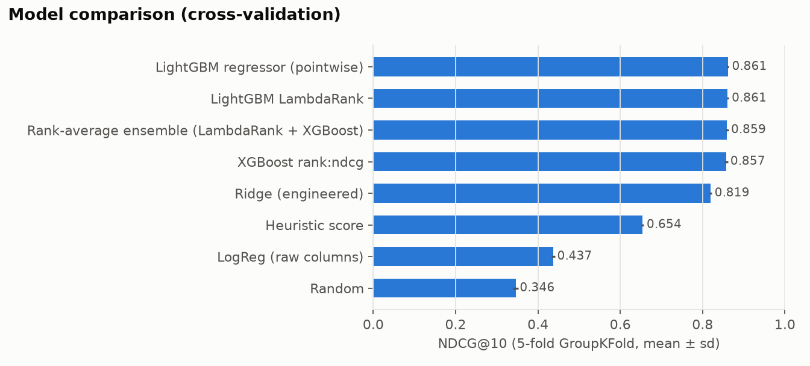
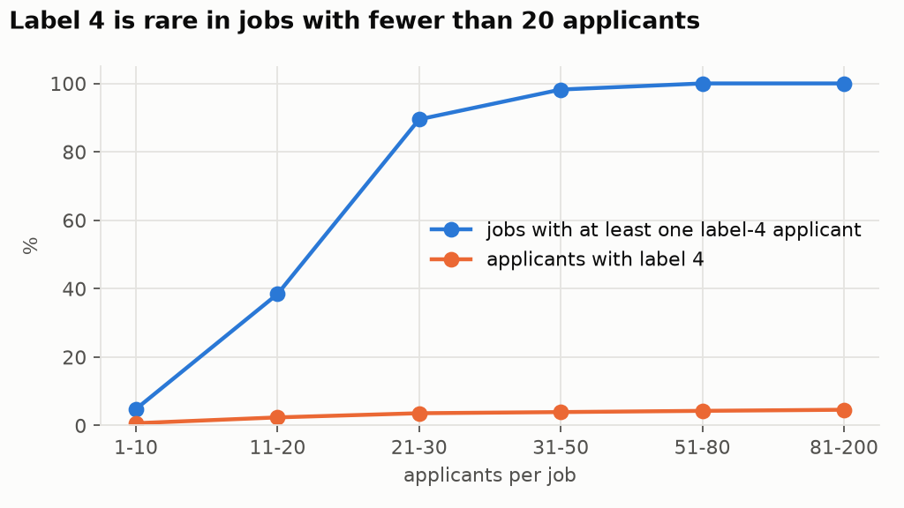
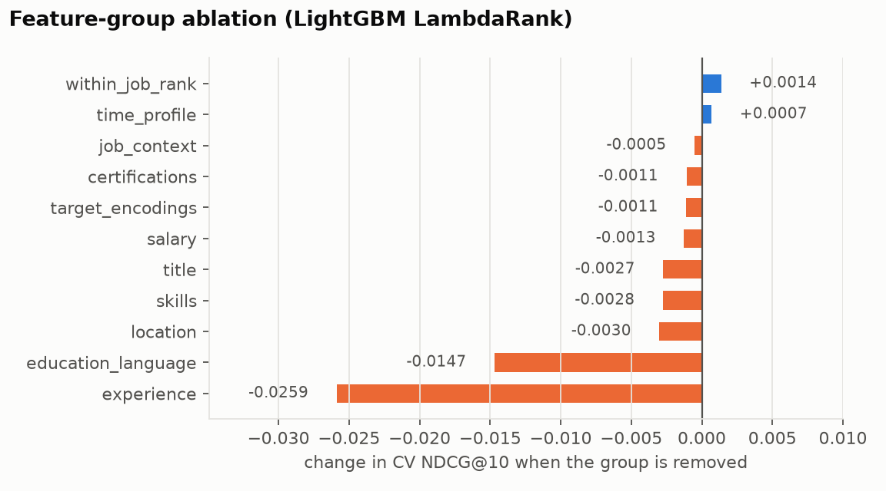
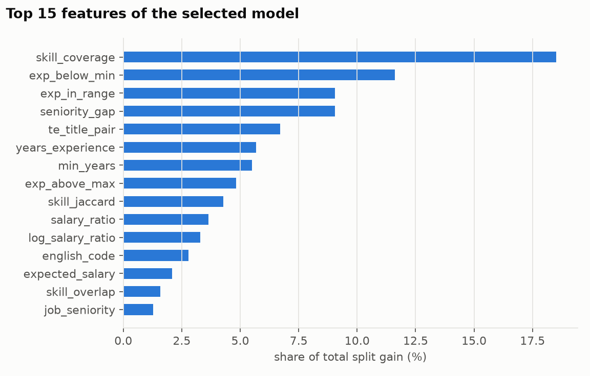

# Ranking Job Applicants with Learning to Rank

**For each job posting, order its applicants from best to worst fit — with leak-free cross-validation,
eight models, a feature-group ablation and a single, final look at the test set.**


A recruiter looking at one job cares about the *order* of its applicants, not about a score that is
comparable across jobs. That makes this a learning-to-rank problem: every job is a query, its applicants
are the documents, and quality is measured inside each job.

* **Data:** 5,000 synthetic tech job postings, 50,000 candidate profiles, 171,472 applications with a
  graded fit label from 0 (no fit) to 4 (ideal). Training applications are from 2023-01 to 2024-06,
  test applications from 2024-07 to 2025-01.
* **Metric:** NDCG@10 with exponential gain (2<sup>label</sup> − 1), computed per job and averaged over
  jobs. MAP@5 (relevant = label ≥ 3) is reported alongside it.
* **Constraint:** classical machine learning only (no neural networks, no pre-trained embeddings).

## Results at a glance

| model (trained on all training data) | test NDCG@10 [95% CI] | test MAP@5 |
|---|---|---|
| random order | 0.345 | 0.107 |
| logistic regression on raw columns (no feature engineering) | 0.424 | 0.182 |
| hand-written fit score (no learning) | 0.653 | 0.391 |
| ridge regression on engineered features | 0.804 | 0.608 |
| **LightGBM LambdaRank, selected by cross-validation** | **0.858** [0.852, 0.863] | **0.699** |

* **Feature engineering is the main driver.** The same 12 raw columns given to logistic regression reach
  0.42; job–candidate *interaction* features take a linear model to 0.80 and gradient boosting to 0.86.
* **Pointwise vs. pairwise barely matters here.** A LightGBM regressor, LightGBM LambdaRank and XGBoost
  `rank:ndcg` are within 0.005 NDCG of each other in cross-validation and on the test set.
* **Cross-validation predicted the test score.** 5-fold GroupKFold gave 0.863 ± 0.002 for the selected
  configuration; the test set gave 0.858.



---

## 1. Data audit

`ltr/data.py` · `scripts/01_data_audit.py` → [`results/data_audit.json`](results/data_audit.json)

The raw files contain deliberate, realistic inconsistencies. Each was counted and handled explicitly:

| issue | rows affected | handling |
|---|---|---|
| salary currency written as `usd`, `USD `, `eur`, … | 96 jobs | trim + upper-case → USD / EUR / IRR |
| job salaries in three currencies (IRR values up to 1.3 × 10<sup>10</sup>) | 1,949 non-USD jobs | converted to USD; the IRR rate (≈ 41,600 per USD) is **estimated from the data** by comparing median salaries of identical job titles |
| candidate `expected_salary` has no currency | all | its distribution is identical in every city (median 92.4k in Iranian cities vs 92.3k elsewhere), so it is treated as USD |
| job posting dates in two formats (`YYYY-MM-DD` and `DD/MM/YYYY`) | 102 jobs | both formats parsed explicitly, day first |
| negative minimum experience (−1) | 96 jobs | set to missing |
| title spelling variants (`Sr.`, `Jr.`, casing, trailing spaces) | 363 jobs, 3,526 candidates | normalised; 38 distinct titles remain |
| city casing variants (`LONDON`, `sydney`) | 1,522 candidates | normalised |
| education written 14 ways (`B.S.`, `BSc`, `Ph.D.`, `HS`, …) | 932 candidates | mapped to 4 ordered levels |
| English level on two scales (CEFR and plain words such as *Upper-Intermediate*, *Native*) | 7,679 candidates | mapped to the CEFR scale A1 … C2 |
| missing values (certifications 56%, university 25%, relocation 15%, English 10%, experience 8%, …) | — | kept as missing (tree models use missingness directly), with explicit `exp_missing` flags |

Three facts about the labels shaped the modelling:

1. **Labels are relative to the other applicants of the same job.** Every job has almost the same label
   mix (≈ 36% / 30% / 20% / 10% / 4% for labels 0–4; the job-level mean label varies with a standard
   deviation of only 0.05 across large jobs). So a label means "top 5% of *this* job's applicants",
   job-level attributes alone cannot move the ranking, and the centred label (label − job mean) is the
   right target for encodings.
2. **The top label depends on how many people applied.** 95% of jobs with 20+ applicants have a label-4
   applicant, but only 26% of smaller jobs do (see figure), so small jobs have a different label scale.
3. **Most test jobs are new.** Only 13.5% of test jobs also appear in training (89% of test candidates
   do). Validation therefore has to hold out *whole jobs*.



## 2. Features

`ltr/features.py`, `ltr/encoding.py` — 51 features in 11 groups; the selected model uses 41 of them.

| group | features | why |
|---|---|---|
| skills | overlap count, coverage of required skills, Jaccard, #required, #candidate skills | does the candidate have what the job asks for? |
| experience | years, job min/max, years below min, years above max, in range, missing flag | under- and over-qualification are different failures |
| title | job / candidate seniority (junior → lead), seniority gap, role-family match, title-token Jaccard, same title | a junior web developer is not a fit for a head-of-data post |
| location | same city, job remote policy, willing to relocate, remote candidate / job | can the candidate actually work there? |
| salary | expected ÷ offered mid-point, its log, inside the offered band, both amounts in USD | expectation mismatch in both directions |
| education & language | education level, CEFR level | general profile strength |
| certifications | count, counts per domain (cloud, containers/IaC, security, delivery, finance) | specialist signals |
| job context | company size, industry, #applicants | context for interactions |
| time & profile | profile completeness, account age, days since posting, month, weekday | tested and **dropped**: no signal (see §4) |
| within-job ranks | percentile of coverage / experience / salary / title fit / heuristic among the job's applicants | tested and **dropped**: the trees already rank within a job |
| target encodings | title-pair fit, certification × industry fit | learned from labels, out of fold (below) |

**Out-of-fold target encoding.** Two interactions are too sparse to hand-code but learnable from labels:
how well a *current title* suits a *job title* (38 × 38 pairs), and how useful each certification is in
each industry. Both encode the **job-centred** label with additive smoothing towards 0. Training rows
always receive encodings fitted on other jobs only (inner GroupKFold), and validation/test rows receive
encodings fitted on the training part only; a unit test checks that a job's encodings do not change when
its own labels are changed.

## 3. Validation and model comparison

`ltr/cv.py`, `scripts/02_compare_models.py` → [`results/cv_model_comparison.csv`](results/cv_model_comparison.csv)

* **5-fold GroupKFold on `job_id`:** all applicants of a job are in the same fold, as in the test set.
* Target encodings are re-fitted inside every fold.
* All model and feature choices are made on these folds. The test labels are read only by
  `scripts/04_select_and_test.py`, after the choice is fixed.
* A separate time-based check (train before 2024-04, validate on 2024-04 … 06) gives NDCG@10 = 0.872,
  in line with the group folds: the problem shows no drift over time.

| model | CV NDCG@10 (mean ± sd) | CV MAP@5 | test NDCG@10 |
|---|---|---|---|
| random | 0.346 ± 0.006 | 0.107 | 0.345 |
| logistic regression, raw columns, label ≥ 3 vs rest | 0.437 ± 0.005 | 0.196 | 0.424 |
| hand-written fit score (5 equally weighted parts) | 0.654 ± 0.003 | 0.386 | 0.653 |
| ridge regression, engineered features | 0.819 ± 0.003 | 0.625 | 0.804 |
| LightGBM regressor (pointwise) | 0.861 ± 0.002 | 0.697 | 0.857 |
| LightGBM LambdaRank | 0.861 ± 0.003 | 0.699 | 0.857 |
| XGBoost `rank:ndcg` | 0.857 ± 0.004 | 0.694 | 0.852 |
| rank-average ensemble (LambdaRank + XGBoost) | 0.859 ± 0.003 | 0.696 | 0.854 |

Ranking objectives do not beat a pointwise regressor here, most likely because the label already is a
within-job rank: predicting it well and ordering by it are nearly the same task.

## 4. Feature-group ablation

`scripts/03_ablation.py` → [`results/ablation.csv`](results/ablation.csv)



| group | CV NDCG@10 when **removed** (Δ) | CV NDCG@10 when **used alone** |
|---|---|---|
| experience | 0.835 (−0.026) | 0.580 |
| education & language | 0.846 (−0.015) | 0.413 |
| location | 0.858 (−0.003) | 0.410 |
| skills | 0.858 (−0.003) | 0.547 |
| title | 0.858 (−0.003) | 0.516 |
| salary | 0.860 (−0.001) | 0.546 |
| target encodings | 0.860 (−0.001) | 0.521 |
| certifications | 0.860 (−0.001) | 0.383 |
| job context | 0.860 (−0.001) | 0.349 |
| time & profile | 0.862 (+0.001) | 0.353 |
| within-job ranks | 0.862 (+0.001) | 0.757 |
| *all features* | *0.861* | |

* **Experience and education/language carry information no other group has**; removing either costs the
  most.
* **Skills, title and salary are strong alone but redundant together** — e.g. skill coverage and seniority
  also enter the within-job ranks — so removing one of them costs little.
* **Time, profile and job-context features are at random level when used alone** (0.35); removing them
  slightly helps. They were dropped from the final model, together with the within-job ranks.

## 5. Final model

`scripts/04_select_and_test.py` → [`results/test_results.csv`](results/test_results.csv),
[`results/test_breakdown.json`](results/test_breakdown.json), [`results/selection_grid.csv`](results/selection_grid.csv)

A grid of 2 feature sets × 5 LightGBM settings was scored with the same folds. The winner — 41 features,
LambdaRank, 1,200 trees, learning rate 0.015, 31 leaves — scored 0.863 in CV, and every configuration in
the grid lay between 0.859 and 0.863, so the result is not sensitive to tuning. Re-trained on all
training data, it scores **NDCG@10 = 0.858 (95% bootstrap CI over jobs 0.852–0.863), MAP@5 = 0.699**
on the 1,541 test jobs.

| test subset | jobs | NDCG@10 | MAP@5 |
|---|---|---|---|
| job not seen in training | 1,333 | 0.853 | 0.693 |
| job also in training | 208 | 0.889 | 0.743 |
| ≤ 10 applicants | 93 | 0.923 | 0.824 |
| 11–20 | 308 | 0.892 | 0.737 |
| 21–40 | 697 | 0.844 | 0.650 |
| 41–80 | 390 | 0.842 | 0.712 |
| > 80 | 53 | 0.849 | 0.886 |

Jobs seen in training score higher partly because their test part tends to be small (the job opened
before the cut-off, so only its last applicants fall in the test period); small jobs are easier for
NDCG@10, since the top 10 covers most of the list.



Skill coverage, being below the required experience, and the seniority gap carry the most gain,
followed by the learned title-pair encoding.

## Limitations

* The data are synthetic, so the absolute scores say little about real recruiting; the relative
  conclusions (feature engineering ≫ model choice, group-aware validation) are the transferable part.
* Labels are relative within a job, and the label-4 scale depends on job size; NDCG on small jobs is
  therefore not directly comparable with NDCG on large ones.
* Exchange rates: IRR is estimated from the data, EUR uses a fixed 1.08 USD; small rate errors only shift
  salary ratios for those jobs.

## Reproduce

```bash
python3.11 -m venv .venv && source .venv/bin/activate
pip install -r requirements.txt     # on macOS LightGBM/XGBoost also need: brew install libomp
# put the CSV files in data/ (see data/README.md)
./run_all.sh                        # about 15 minutes on a laptop, deterministic
```

The unit tests (`python -m pytest -q tests`, 11 tests: metrics, cleaning, title parsing, out-of-fold
encoding) need no data and run in CI.

```
ltr/            data.py (loading + cleaning)  features.py  encoding.py (OOF target encoding)
                metrics.py (NDCG@10, AP@5)    models.py    cv.py (GroupKFold)    plotting.py
scripts/        01_data_audit.py  02_compare_models.py  03_ablation.py  04_select_and_test.py
results/        csv / json results and figures/
tests/          unit tests
```

## License

MIT — see [LICENSE](LICENSE).
