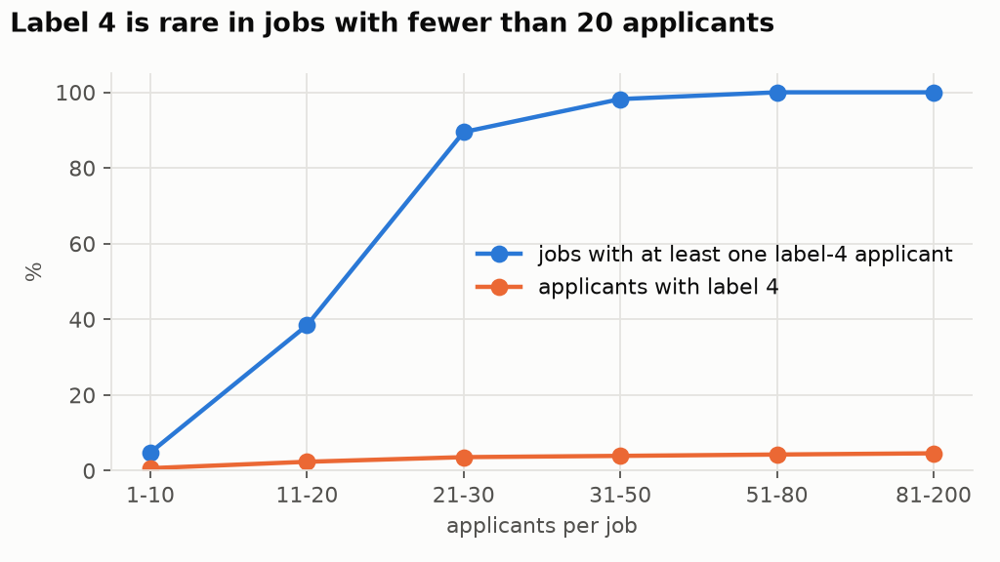
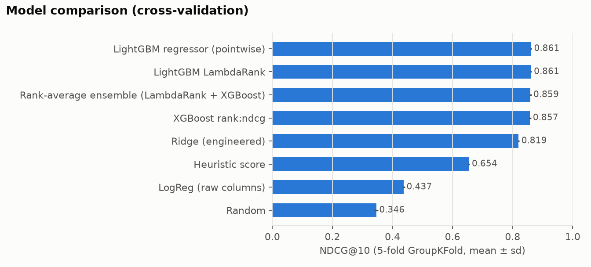
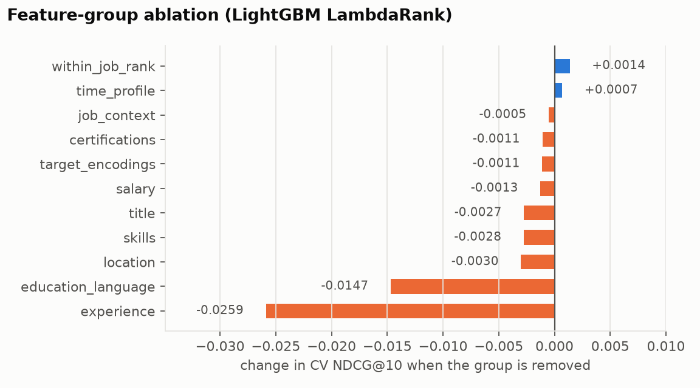
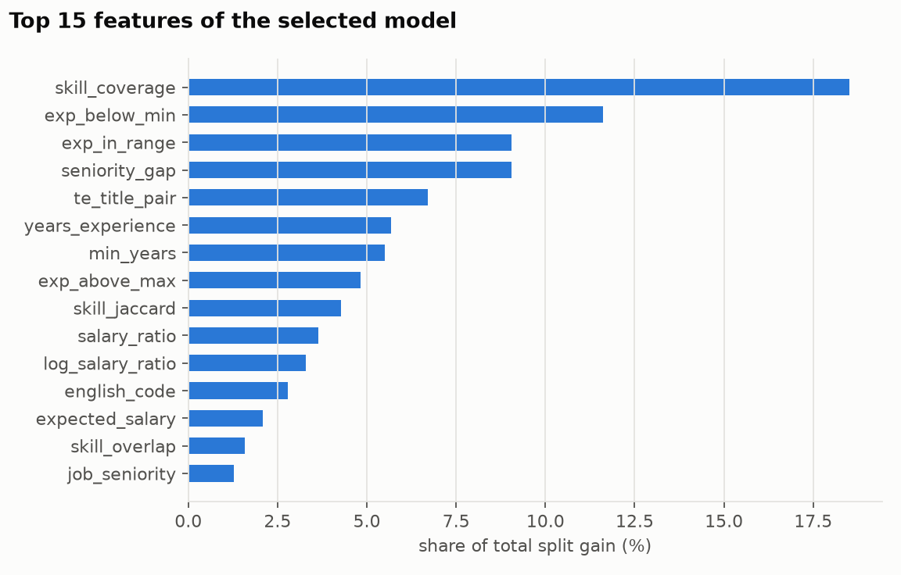

# Report: Ranking Job Applicants with Learning to Rank

This report describes the data audit, the features, the validation protocol, the model comparison, the ablation and the final test evaluation. Every number comes from the files in [`results/`](results/), written by the four scripts in [`scripts/`](scripts/) (`run_all.sh` runs them in order).

## Contents

1. [Problem and setup](#1-problem-and-setup)
2. [Data audit](#2-data-audit)
3. [Features](#3-features)
4. [Validation and model comparison](#4-validation-and-model-comparison)
5. [Feature-group ablation](#5-feature-group-ablation)
6. [Final model and test results](#6-final-model-and-test-results)
7. [Limitations](#7-limitations)
8. [Reproducibility](#8-reproducibility)

---

## 1. Problem and setup

A recruiter looking at one job cares about the order of its applicants, not about a score that is comparable across jobs. This makes the problem learning to rank: every job is a query, its applicants are the documents, and quality is measured inside each job.

- **Data:** 5,000 synthetic tech job postings, 50,000 candidate profiles and 171,472 applications, each with a graded fit label from 0 (no fit) to 4 (ideal). Training applications run from 2023-01 to 2024-06, test applications from 2024-07 to 2025-01.
- **Metric:** NDCG@10 with exponential gain (2<sup>label</sup> − 1) and log2 discount, computed per job and averaged over jobs. Jobs whose applicants all have label 0 are skipped, because NDCG is undefined for them. MAP@5 (relevant = label ≥ 3, normalised by min(#relevant, 5)) is reported alongside.
- **Models:** classical machine learning only, from a hand-written score and linear models to gradient-boosted rankers. No neural networks or pre-trained embeddings are used.

## 2. Data audit

Code: `ltr/data.py`, `scripts/01_data_audit.py`. Output: [`results/data_audit.json`](results/data_audit.json).

The raw files contain many inconsistencies. Each one was counted before deciding how to handle it:

| Issue | Rows affected | Handling |
|---|---|---|
| Salary currency written as `usd`, `USD `, `eur`, … | 96 jobs | trim and upper-case to USD / EUR / IRR |
| Job salaries in three currencies (IRR values up to 1.3 × 10<sup>10</sup>) | 1,949 non-USD jobs | converted to USD; the IRR rate (about 41,600 per USD) is estimated from the data by comparing median salaries of identical job titles |
| Candidate `expected_salary` has no currency | all | its distribution is the same in every city (median 92.4k in Iranian cities, 92.3k elsewhere), so it is treated as USD |
| Job posting dates in two formats (`YYYY-MM-DD` and `DD/MM/YYYY`) | 102 jobs | both formats parsed, day first |
| Negative minimum experience (−1) | 96 jobs | set to missing |
| Title spelling variants (`Sr.`, `Jr.`, casing, trailing spaces) | 363 jobs, 3,526 candidates | normalised; 38 distinct titles remain |
| City casing variants (`LONDON`, `sydney`) | 1,522 candidates | normalised |
| Education written 14 ways (`B.S.`, `BSc`, `Ph.D.`, `HS`, …) | 932 candidates | mapped to 4 ordered levels |
| English level on two scales (CEFR, and words such as *Upper-Intermediate* or *Native*) | 7,679 candidates | mapped to CEFR A1 … C2 |
| Missing values (certifications 56%, university 25%, relocation 15%, English 10%, experience 8%, …) | | kept as missing, since tree models use missingness directly, with `exp_missing` flags |

Three facts about the labels shaped the modelling:

1. **Labels are relative to the other applicants of the same job.** Every job has almost the same label mix (about 36% / 30% / 20% / 10% / 4% for labels 0–4), and the job-level mean label has a standard deviation of only 0.05 across large jobs. A label therefore means something like "top 5% of this job's applicants". Job-level attributes alone cannot change the order, and the centred label (label minus the job mean) is the right target for encodings.
2. **The top label depends on how many people applied.** 95% of jobs with 20 or more applicants have a label-4 applicant, against 26% of smaller jobs, so small jobs have a different label scale.
3. **Most test jobs are new.** Only 13.5% of test jobs also appear in training, while 89% of test candidates do. Validation therefore has to hold out whole jobs.



## 3. Features

Code: `ltr/features.py`, `ltr/encoding.py`. There are 51 features in 11 groups; the selected model uses 41 of them.

| Group | Features | Reason |
|---|---|---|
| skills | overlap count, coverage of required skills, Jaccard, #required, #candidate skills | does the candidate have what the job asks for? |
| experience | years, job min/max, years below min, years above max, in range, missing flag | under- and over-qualification are different failures |
| title | job and candidate seniority (junior to lead), seniority gap, role-family match, title-token Jaccard, same title | a junior web developer does not fit a head-of-data post |
| location | same city, job remote policy, willing to relocate, remote candidate or job | can the candidate actually work there? |
| salary | expected ÷ offered mid-point, its log, inside the offered band, both amounts in USD | mismatch in both directions |
| education and language | education level, CEFR level | general profile strength |
| certifications | count, counts per domain (cloud, containers/IaC, security, delivery, finance) | specialist signals |
| job context | company size, industry, #applicants | context for interactions |
| time and profile | profile completeness, account age, days since posting, month, weekday | tested and dropped: no signal (Section 5) |
| within-job ranks | percentile of coverage, experience, salary, title fit and the heuristic among the job's applicants | tested and dropped: the trees already rank within a job |
| target encodings | title-pair fit, certification × industry fit | learned from labels, out of fold (below) |

There is also a hand-written fit score (`heuristic_score`): five parts scaled to [0, 1] and weighted equally (skill coverage, experience fit, title fit, location fit, salary fit). It serves both as a baseline and as a feature.

**Out-of-fold target encoding.** Two interactions are too sparse to hand-code but can be learned from labels: how well a candidate's current title suits a job title (38 × 38 pairs), and how useful each certification is in each industry. Both encode the job-centred label, with additive smoothing towards 0. Training rows always get encodings fitted on other jobs only (an inner GroupKFold), and validation or test rows get encodings fitted on the training part only. A unit test checks that a job's encodings do not change when its own labels change.

## 4. Validation and model comparison

Code: `ltr/cv.py`, `scripts/02_compare_models.py`. Output: [`results/cv_model_comparison.csv`](results/cv_model_comparison.csv).

- **5-fold GroupKFold on `job_id`:** all applicants of a job are in the same fold, as in the test set.
- Target encodings are re-fitted inside every fold.
- All model and feature choices are made on these folds. The test labels are read only by `scripts/04_select_and_test.py`, after the choice is fixed.
- A separate time-based check (train before 2024-04, validate on 2024-04 to 2024-06, 821 jobs) gives NDCG@10 = 0.872, in line with the group folds, so there is no visible drift over time.

| Model | CV NDCG@10 (mean ± sd) | CV MAP@5 | Test NDCG@10 |
|---|---|---|---|
| random | 0.346 ± 0.006 | 0.107 | 0.345 |
| logistic regression, raw columns, label ≥ 3 vs rest | 0.437 ± 0.005 | 0.196 | 0.424 |
| hand-written fit score | 0.654 ± 0.003 | 0.386 | 0.653 |
| ridge regression, engineered features | 0.819 ± 0.003 | 0.625 | 0.804 |
| LightGBM regressor (pointwise) | 0.861 ± 0.002 | 0.697 | 0.857 |
| LightGBM LambdaRank | 0.861 ± 0.003 | 0.699 | 0.857 |
| XGBoost `rank:ndcg` | 0.857 ± 0.004 | 0.694 | 0.852 |
| rank-average ensemble (LambdaRank + XGBoost) | 0.859 ± 0.003 | 0.696 | 0.854 |



Ranking objectives do not beat a pointwise regressor here. The likely reason is that the label already is a within-job rank, so predicting it well and ordering by it are nearly the same task.

## 5. Feature-group ablation

Code: `scripts/03_ablation.py`. Output: [`results/ablation.csv`](results/ablation.csv).

Each group is removed in turn, and since groups overlap (the heuristic and the rank features repeat skill information), each group is also used on its own.



| Group | CV NDCG@10 when removed (Δ) | CV NDCG@10 when used alone |
|---|---|---|
| experience | 0.835 (−0.026) | 0.580 |
| education and language | 0.846 (−0.015) | 0.413 |
| location | 0.858 (−0.003) | 0.410 |
| skills | 0.858 (−0.003) | 0.547 |
| title | 0.858 (−0.003) | 0.516 |
| salary | 0.860 (−0.001) | 0.546 |
| target encodings | 0.860 (−0.001) | 0.521 |
| certifications | 0.860 (−0.001) | 0.383 |
| job context | 0.860 (−0.001) | 0.349 |
| time and profile | 0.862 (+0.001) | 0.353 |
| within-job ranks | 0.862 (+0.001) | 0.757 |
| *all features* | *0.861* | |

- Experience and education/language carry information that no other group has; removing either costs the most.
- Skills, title and salary are strong alone but redundant together. Skill coverage and seniority, for example, also enter the within-job ranks, so removing one of these groups costs little.
- Time, profile and job-context features are at random level on their own (0.35), and removing them helps slightly. They were dropped from the final model, together with the within-job ranks.

## 6. Final model and test results

Code: `scripts/04_select_and_test.py`. Outputs: [`results/test_results.csv`](results/test_results.csv), [`results/test_breakdown.json`](results/test_breakdown.json), [`results/selection_grid.csv`](results/selection_grid.csv).

A grid of 2 feature sets × 5 LightGBM settings was scored with the same folds. The winner (41 features, LambdaRank, 1,200 trees, learning rate 0.015, 31 leaves) scored 0.863 in CV. Every configuration in the grid scored between 0.859 and 0.863, so the result does not depend on fine tuning.

Re-trained on all training data, it scores **NDCG@10 = 0.858** (95% bootstrap CI over jobs: 0.852–0.863) and **MAP@5 = 0.699** on the 1,541 test jobs.

| Model (trained on all training data) | Test NDCG@10 | Test MAP@5 |
|---|---|---|
| random order | 0.345 | 0.107 |
| logistic regression on raw columns | 0.424 | 0.182 |
| hand-written fit score | 0.653 | 0.391 |
| ridge regression on engineered features | 0.804 | 0.608 |
| **LightGBM LambdaRank, selected by CV** | **0.858** | **0.699** |

Breakdown of the selected model:

| Test subset | Jobs | NDCG@10 | MAP@5 |
|---|---|---|---|
| job not seen in training | 1,333 | 0.853 | 0.693 |
| job also in training | 208 | 0.889 | 0.743 |
| ≤ 10 applicants | 93 | 0.923 | 0.824 |
| 11–20 | 308 | 0.892 | 0.737 |
| 21–40 | 697 | 0.844 | 0.650 |
| 41–80 | 390 | 0.842 | 0.712 |
| > 80 | 53 | 0.849 | 0.886 |

Jobs seen in training score higher partly because their test part tends to be small: the job opened before the cut-off, so only its last applicants fall in the test period. Small jobs are easier for NDCG@10, since the top 10 covers most of the list.



Skill coverage, being below the required experience and the seniority gap carry the most gain, followed by the learned title-pair encoding.

## 7. Limitations

- The data is synthetic, so absolute scores say little about real recruiting. The relative findings (feature engineering matters far more than the choice of model, and validation has to be group-aware) are the part that transfers.
- Labels are relative within a job and the label-4 scale depends on job size, so NDCG on small jobs is not directly comparable with NDCG on large ones.
- The IRR rate is estimated from the data and EUR uses a fixed 1.08 USD. Small rate errors only shift salary ratios for those jobs.

## 8. Reproducibility

```bash
python3.11 -m venv .venv && source .venv/bin/activate
pip install -r requirements.txt     # on macOS LightGBM and XGBoost also need: brew install libomp
# put the CSV files in data/ (see data/README.md)
./run_all.sh                        # about 15 minutes on a laptop, deterministic
```

| Script | Output |
|---|---|
| `01_data_audit.py` | `data_audit.json`, label and job-size figures |
| `02_compare_models.py` | `cv_model_comparison.csv`, `time_split_check.json`, comparison figure |
| `03_ablation.py` | `ablation.csv`, ablation figure |
| `04_select_and_test.py` | `selection_grid.csv`, `test_results.csv`, `test_breakdown.json`, `test_predictions.csv`, feature importance |

The 11 unit tests (`python -m pytest -q tests`) cover the metrics, the cleaning rules, title parsing and the out-of-fold encoding. They need no data and run in CI.
